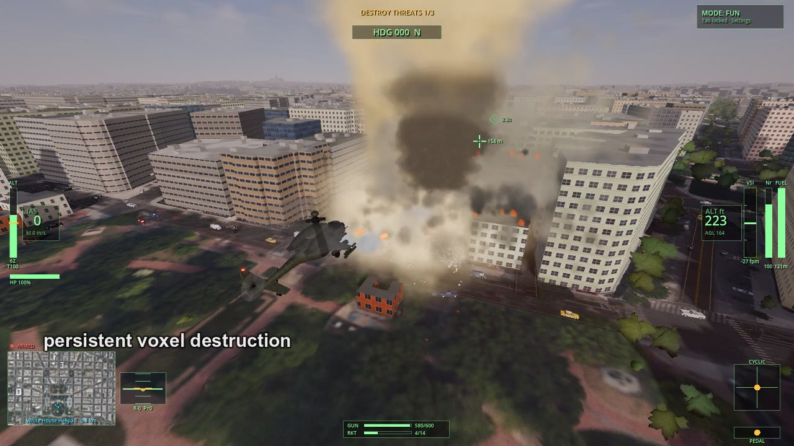
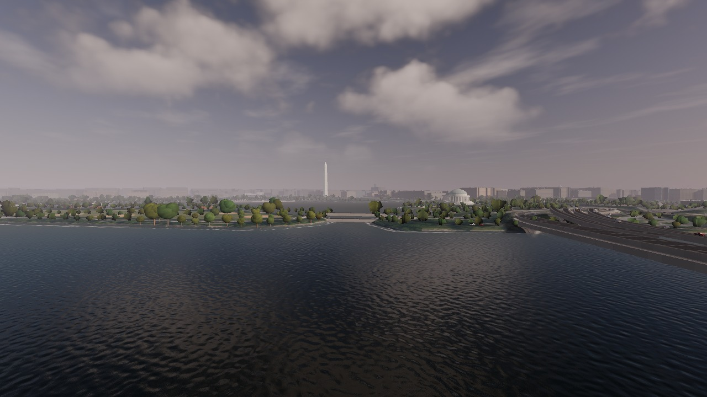
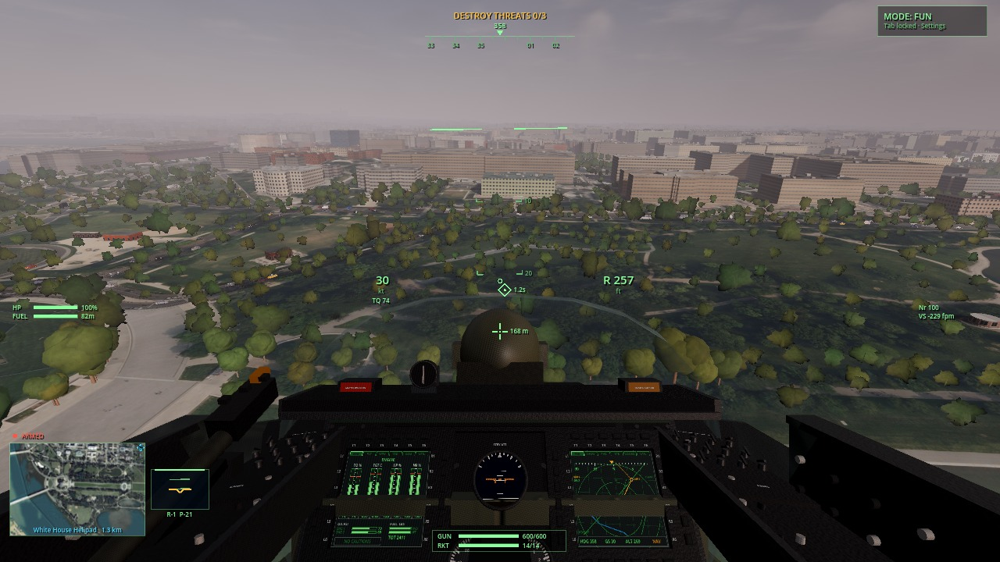
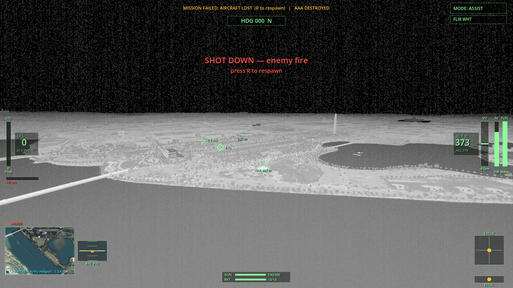
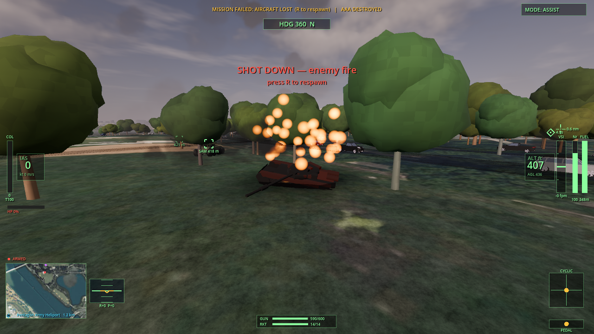

# Rotorwash: Ground Truth

*Click the image for the highlight reel (2 min 36 s, with sound).*

Helicopter combat over real US cities. The terrain, the streets, the bridges,
and the buildings come from public survey data. Free for macOS and Windows.

This is the second Rotorwash. The first one flies a procedural island and
lives at [rotorwash-game](https://github.com/devnullnoop/rotorwash-game).
Both run the same blade-element flight model.

## Download and install

Grab the game and at least one city from the
[latest release](../../releases/latest).

1. Unzip the game anywhere.
2. Make a folder named `packs` next to the app (macOS) or next to
   `GroundTruth.exe` (Windows).
3. Unzip each city into it, so it looks like `packs/dc`, `packs/nyc`,
   `packs/sf`, `packs/miami`.
4. Start the game, press Esc, pick the city, restart.

macOS: the app is signed ad hoc, not notarized. Right-click, Open, then Open
again on first run. Windows: SmartScreen warns on first run. Click More info,
then Run anyway.

## Hardware

| | Minimum | Comfortable |
|---|---|---|
| CPU | 4 cores | 6+ cores |
| RAM | 8 GB | 16 GB |
| GPU | Vulkan capable (GTX 1060 / RX 580 class), or any Apple Silicon | GTX 1660 / RX 5600 or better |
| Disk | 1 GB game + 0.4 to 0.7 GB per city | all four cities, about 3 GB total; optional DC detail imagery adds 2.5 GB |
| OS | macOS 11 / Windows 10 64-bit | |

Development and testing happen on Apple Silicon. The Windows build comes off
a build server and boots clean there, but it has had less human flight time.
If something is wrong on your machine, open an issue with your GPU model.

## What is in the box

- Four flyable cities built from USGS 1 m terrain, aerial imagery, and
  OpenStreetMap vectors: Washington DC, New York, Miami, San Francisco.
- A validated blade-element flight model with four assist levels, from full
  realism to a forgiving mode anyone can fly.
- Weapons with a real fire-control HUD: gun with impact pip, rockets with a
  computed impact point, target boxes with range.
- Destruction that stays. Bullets chip buildings voxel by voxel. Rockets
  collapse them. Kills leave burning wrecks for the whole session.
- Fire that behaves like fire. Explosions mushroom, collapse, and feed
  columns of smoke that lean with the wind. Burning buildings carry wide
  fire fronts. The flame and blast shapes are baked from fluid simulations
  and checked against real footage.
- Living streets: traffic that drives, panics near explosions, and avoids
  fires.
- Sensors: night vision, white-hot and black-hot thermal, and an ironbow
  palette. TADS-style zoom in the cockpit.
- A first-person cockpit with live multifunction displays and IHADSS-style
  symbology.
- Synthesized audio, including the speed-of-sound delay on distant
  explosions.

## The data, and how deep it goes

Most city games draw a skyline that looks right from a distance. This one is
assembled from measurements.

- Terrain is USGS 3DEP lidar at 1 meter per post.
- Bridge decks are recovered from the lidar point cloud, so traffic crosses
  the Brooklyn Bridge at its real deck height.
- The ground texture in Washington is the city's own 2023 orthophoto
  flight. Parked cars and aircraft are washed out of the photographs and
  placed as 3D objects, so nothing on the ground is painted on. The other
  cities use USDA NAIP aerial imagery.
- Buildings are OpenStreetMap footprints with recorded heights.
- Trees are individuals. A per-tree canopy map places each one, so the rows
  on the National Mall match the real plantings.
- Traffic density per road comes from published AADT counts, the annual
  average daily traffic a road authority measures for each segment.
- Helipads are the real ones. Land on the pad at National Airport and the
  game rearms you there.
- The water level in each city sits at the surveyed tide datum.

## Controls

W/S collective, arrow keys cyclic, Q/E pedals. SPACE gun, CTRL rockets.
V cycles chase, high, and cockpit views. N cycles the sensors. Tab cycles
assist levels. In the cockpit with thermal on, the mouse wheel zooms.
Esc opens settings. Land on a friendly helipad to rearm, repair, and refuel.
A gamepad works: left stick collective and pedals, right stick cyclic.

## License

The game and the city packs are free to download and play. City packs contain
compiled meshes and textures derived from USGS, the District of Columbia
OCTO Orthophoto 2023 (CC BY 4.0), Virginia VBMP (VGIN), USDA NAIP, and
OpenStreetMap (ODbL) sources. Third-party credits ship inside the game.
